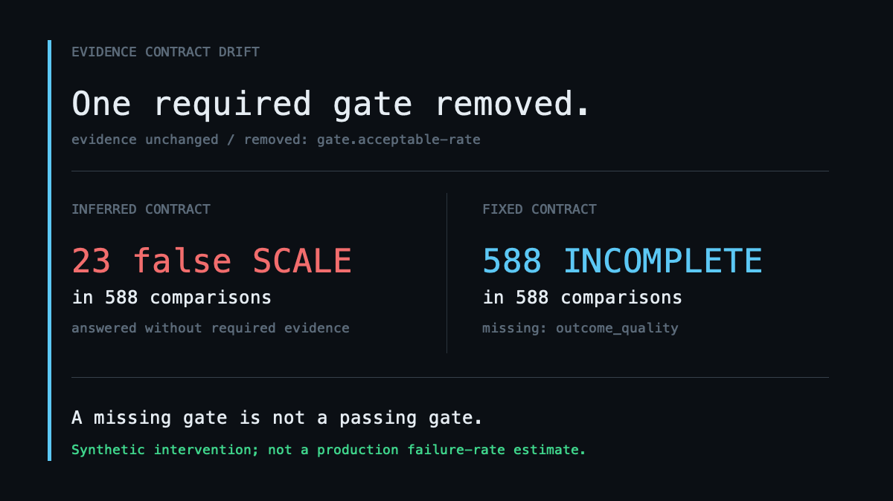
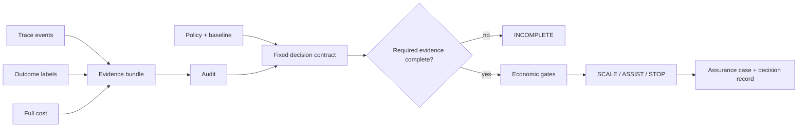

# Agent Economics Lab

**Your agent says it worked. Prove it.**

Turn model and agent traces, independently checked outcomes, full cost, and a
named alternative into a decision someone else can reproduce. Missing evidence
is a result, never an implied pass.

```text
traces + outcomes + prices + baseline + policy
                        |
                        v
         replay + audit + cost-quality frontier
                        |
                        v
        SCALE | ASSIST | STOP | INCOMPLETE
```

[Run the bundled case](#run-it) ·
[open the decision record](https://vyoma.github.io/agent-economics-lab/decision-record.html) ·
[inspect the public case](examples/public-swebench/) ·
[follow the production feedback contract](docs/production-feedback-loops.md)

### Run it

```bash
uvx --from git+https://github.com/Vyoma/agent-economics-lab@v0.10.1 agent-economics demo
```

Python 3.10+, standard library only, no API key or account. The command installs
the versioned `v0.10.1` release, replays data shipped inside it, and explains why
it issued `ASSIST`. Extract the same contract to replace the fixture with your
own runs:

```bash
uvx --from git+https://github.com/Vyoma/agent-economics-lab@v0.10.1 \
  agent-economics demo --extract .
```

[](https://github.com/Vyoma/agent-economics-lab/actions/workflows/test.yml)
[](https://github.com/Vyoma/agent-economics-lab/releases/latest)
[](LICENSE)



_Static key frame generated from live decisions and recomputed in tests.
[Open the evidence-bound decision record](https://vyoma.github.io/agent-economics-lab/decision-record.html).
Synthetic intervention; not a production failure-rate estimate._

## Found in the wild

The lab has audited ten public trajectory datasets and filed sixteen results.
Two of the sixteen are clean bills. Negative results and corrections stay in
the same registry as defects.

Three findings show why outcome provenance matters:

| observation | evidence | boundary |
|---|---|---|
| Generated tests barely track adjudicated outcomes | Across 31,389 shared runs, Cohen's kappa is 0.062. The proxy is 2.9 points worse than always choosing the commoner label; its interval excludes zero. | One public dataset and one generated-test signal, not a claim about all graders. |
| Identical trajectories received different labels | Two 500-run arms contain byte-identical transcripts, but `info.resolved` disagrees on 44 tasks. Test-retest agreement is 91.2%. | The aggregate rates happen to match; the per-task labels do not. Cause is not established. |
| A reported perfect arm has no confirmed outcomes | One 500-run arm reports 100.0% resolution and $480.01 over 25,641 API calls, while its own cross-check is unknown for every run. Nine rows record one call, no spend, and a positive outcome. | The source is an independent upload, not a vendor release. This is not a measurement of the named model. |

The full arm-by-arm table, frozen evidence, correction record, and reproduction
commands live in the [outcome audit](research/OUTCOME_AUDIT.md). The broader
[public corpus](research/CORPUS.md) records clean bills with the same care as
defects.

## One end-to-end public case

The worked case uses 40 public mini-SWE-agent trajectories over 20 paired
SWE-bench Verified tasks. The outcome is the hidden-test result, not the agent's
self-report.

| arm | resolved | spend | per resolved | verdict |
|---|---:|---:|---:|---|
| `claude-opus-4.6` | 14/20 (70%) | $8.44 | $0.60 | **STOP** |
| `claude-4.5-haiku-high` | 11/20 (55%) | $5.37 | $0.49 | **STOP** |

The `STOP` is forced, not earned: the public source provides no defensible
business value per resolution, so the example assigns zero value while cost is
positive. The comparison frontier returns `HOLD`, not `ADOPT`; one harmful
transition in 20 pairs leaves a 24.9% upper bound against the predeclared 5%
limit. This is a worked case over one benchmark, not enterprise ROI evidence or
a model ranking.

The claim is executable:

```bash
agent-economics verify \
  --claim research/claims/2026-08-31-swebench-opus-attributed-ae7527bc.claim.json \
  --bundle examples/public-swebench/arms/candidate-opus.json
```

[Inspect the case, attribution boundaries, and frozen source.](examples/public-swebench/)

## What the system decides

Counting successful runs is not enough. A usable result that took twenty model
calls, human cleanup, and an incident is not equivalent to one that took two
calls. The decision contract combines:

- adjudicated task outcomes;
- model, tool, labor, remediation, and incident cost;
- tail risk and runtime caps;
- expected business value;
- a named baseline or counterfactual;
- fixed required evidence that cannot disappear when a check is disabled.

It returns one of four modes:

| mode | meaning |
|---|---|
| `SCALE` | every required gate passed |
| `ASSIST` | keep a person in the loop |
| `STOP` | the measured economics or risk fail hard |
| `INCOMPLETE` | a required check did not run, so there is no decision yet |

The fourth mode is the load-bearing one. “Every enabled check passed” is not the
same claim as “every required check passed.”

## How it works



The package keeps three concerns separate:

1. **Normalize evidence.** CSV, Claude Code, session-tree, and OpenTelemetry
   adapters map source data into one versioned bundle without inventing missing
   economics.
2. **Audit the measuring instrument.** Outcome provenance, label validity,
   delegation closure, cost completeness, and contract coverage can withhold a
   green result.
3. **Issue a reviewable decision.** The engine emits a machine-readable
   assurance case, a claim that can be independently verified, and an optional
   decision record that can fail CI.

[Architecture and methodology](docs/methodology.md) ·
[input contract and adapters](examples/README.md) ·
[prior art and narrow delta](docs/landscape.md)

## Use it on your evidence

Build a normalized bundle from ordinary exports:

```bash
agent-economics bundle \
  --traces traces.csv \
  --outcomes outcomes.csv \
  --rates rates.json \
  --baseline baseline.json \
  --policy policy.json \
  --label-source "my-team.manual-review@v1" \
  --out evidence.bundle.json

agent-economics evaluate --bundle evidence.bundle.json
```

The five input files and their required columns are documented in
[examples/README.md](examples/README.md). Twelve executable recipes cover CSV,
Claude Code, delegated subagents, OpenTelemetry GenAI, an external judge,
contract composition, and CI in [docs/recipes.md](docs/recipes.md).

### Issue a falsifiable claim

```bash
agent-economics claim \
  --bundle evidence.bundle.json \
  --issuer "my-team" \
  --source-commit "$(git rev-parse HEAD)" \
  --assertion "What you are asserting, in your own words." \
  --output decision.claim.json

agent-economics verify \
  --claim decision.claim.json \
  --bundle evidence.bundle.json
```

Verification exits `0` for `SUPPORTED`, `2` for `UNVERIFIED`, and `4` for
`REFUTED`. It recomputes the evidence digest, decision contract, bound checks,
and decision. It verifies the inference against supplied evidence; it does not
prove that the evidence describes reality.

### Put the decision in a record

```bash
agent-economics decision-record init --output decision-record.json
agent-economics decision-record validate decision-record.json \
  --bundle evidence.bundle.json \
  --attestations attestations.json \
  --artifact-root .

agent-economics decision-record render decision-record.json \
  --bundle evidence.bundle.json \
  --attestations attestations.json \
  --artifact-root . \
  --output decision-record.html
```

The record binds the workload, claims, artifacts, counterfactual, cost boundary,
uncertainty, controls, reviewers, and reproduction command. The validator
refuses incomplete records and mismatched evidence. Reviewer names and
`signed_off` are assertions, not digital signatures.

[Filled JSON](examples/agent-decision-record.json) ·
[rendered review card](examples/agent-decision-record.html) ·
[JSON Schema](templates/agent-decision-record.schema.json)

### Close the production feedback loop

The [Production Feedback Contract](docs/production-feedback-loops.md) carries a
versioned decision into delayed outcomes without pretending predictive models,
generative systems, and tool-using agents require identical evidence. It names
the primary outcome, allowed proxies, modality-specific checks, interventions,
owners, and rollback triggers.

```bash
python3 -m agent_economics.feedback_contract \
  examples/production-feedback-contract.json
```

The example is synthetic. The validator proves structural completeness and a
digest over supplied policy, not the truth of an outcome label or rollout claim.

## Evidence against the system itself

This repository tests its own claims more aggressively than its headline.

| question | result | read the boundary |
|---|---|---|
| Can removing a required gate create a false green? | A dynamic contract returns 23 false `SCALE` transitions in 588 synthetic comparisons. The fixed contract returns `INCOMPLETE` in all 588. | [Protocol](research/FALSE_GREEN_PROTOCOL.md) |
| Can a permissive replacement gate evade routing? | Yes. Under substitution, fixed and dynamic routing both fail to detect 23 of 510 non-equivalent mutants. | [Mutation score](research/results/mutation-score/summary.md) |
| Is the implementation fingerprint complete? | No. It hashes each check's source, not transitive helpers. A shared-helper edit can change a verdict without changing the contract digest. | [Honest limitations](docs/limitations.md) |
| Are the synthetic verdicts stable? | 55 of 98 scenarios are brittle across the declared cost-assumption grid. | [Sensitivity report](research/results/sensitivity/summary.md) |
| Did a green suite prevent measurement defects? | No. Five defects were live across three green commits. The distinct suite total was 1365 tests, not the previously reported 2275. This is a case series, not a rate. | [Defect corpus](research/GREEN_DEFECTS.md) |
| Did a prospective probe generalize? | It found three real defects among 18 pre-registered divergences, or 3/12 counted as distinct sites; a held-out application found nothing. | [Probe results](research/PROBE_RESULTS.md) |

The techniques are not presented as new. The work draws on the oracle problem,
metamorphic testing, differential testing, deviance inference, safety cases,
and required-check semantics. Six earlier novelty claims were narrowed or
retracted after prior-art review. [The correction record and surviving delta](docs/novelty.md)
are part of the project.

## Reproduce it without trusting it

The strongest independent check is 148 lines of Python standard library. It
downloads a pinned public dataset, checks its bytes, and recomputes the headline
grader result without importing this package:

```bash
make reproduce-hle
```

To rebuild every committed artifact, historical regression, adapter output,
public case, finding, and claim ledger:

```bash
git clone https://github.com/Vyoma/agent-economics-lab.git
cd agent-economics-lab
make reproduce
```

Use a full clone; the historical defect checks need commit history. CI runs the
same reproduction surface across Python 3.10 through 3.13. Release wheels are
also installed and exercised without a repository clone.

Any repository can gate on a committed claim:

```yaml
- uses: Vyoma/agent-economics-lab@main
  with:
    claim: path/to/decision.claim.json
    bundle: path/to/evidence.bundle.json
```

## Evidence map

| If you want to inspect | Start here |
|---|---|
| Public datasets, clean bills, defects, and corrections | [Research corpus](research/CORPUS.md) |
| The strongest public outcome-label audit | [Outcome audit](research/OUTCOME_AUDIT.md) |
| Every standing machine-verifiable claim | [Claim ledger](research/claims/LEDGER.md) |
| What the package cannot establish | [Honest limitations](docs/limitations.md) |
| Prior art and the narrow technical delta | [Landscape](docs/landscape.md) |
| Production feedback across predictive, generative, and agent systems | [Feedback-loop contract](docs/production-feedback-loops.md) |
| Practical integrations and commands | [Recipes](docs/recipes.md) |
| Release history and changes | [Changelog](CHANGELOG.md) |

## Contribute evidence

Useful contributions add something another person can refute:

- a pinned, permissioned export mapped to the canonical evidence bundle;
- a typed gate or diagnostic with explicit failure semantics;
- a paired experiment with a frozen task manifest and full-cost boundary;
- an outcome-instrument attestation;
- a counterexample that narrows or falsifies a standing claim;
- an audit of a public dataset, including clean results.

Start with [CONTRIBUTING.md](CONTRIBUTING.md) and
[contributing an audit](docs/contributing-an-audit.md). Do not submit customer
data, secrets, proprietary prompts, or contract pricing.

## Claim boundary

This is a teaching, conformance, and controlled-research lab. It is not a
production authorization layer, accounting system, benchmark leaderboard, or
prevalence study. The bundled support, frontier, and Claude Code fixtures are
synthetic. The public SWE-bench case uses observed benchmark trajectories but
is not enterprise ROI evidence. No external production consumer has validated
the system yet.

Production use requires representative tasks, label validation, assignment
controls, subgroup analysis, complete cost attribution, policy ownership, and
ongoing monitoring.

Apache-2.0 licensed. No third-party runtime dependencies. Derived data,
implemented specifications, and runtime services are credited in
[THIRD_PARTY_NOTICES.md](THIRD_PARTY_NOTICES.md). Participation is governed by
the [Code of Conduct](CODE_OF_CONDUCT.md).
